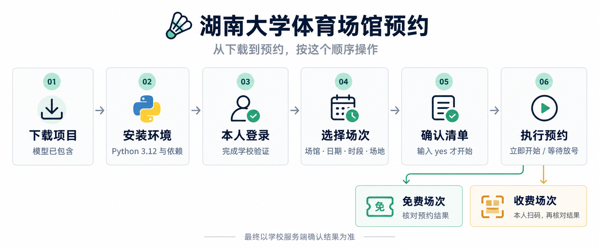

# 湖南大学体育场馆预约助手 🏸

`hnu-sports-booking`：湖南大学（湖大 / HNU）体育场馆预约助手，支持羽毛球预约、健身房预约、乒乓球预约和网球预约。选好日期和时段，确认后开始查询空位，或等到放号时间再执行。收费场次会弹出支付二维码，免费场次直接核对预约结果。

支持的项目从学校预约大厅读取，包括羽毛球、健身房、乒乓球和网球。不同场馆的时间和规则分别处理，不把所有项目都当成一小时的羽毛球场。

**登录验证和扫码付款需要本人完成。这个工具会创建真实预约，请看清最后的确认清单再输入 `yes`。**

## 先看使用顺序

**第一次：下载完整仓库 → 安装 Python 和依赖 → 本人登录 → 打开菜单选场 → 确认预约 → 免费场次确认结果 / 收费场次扫码付款。**



1. **安装只做一次**：在项目文件夹创建 `.venv`，安装 `requirements.txt`。模型已包含在仓库中，不需要另找下载。
2. **首次使用先登录**：运行 `.\.venv\Scripts\python.exe -X utf8 cdp_cookie.py --wait`，在弹出的浏览器中完成验证。
3. **以后直接双击 `一键抢场.bat`**：日期回车选默认，场地回车选不限；时段按编号选择，多段例如 `1,2`。
4. **核对清单后输入 `yes`**。选择「等待放号」时，先同步电脑时间并输入 `sync`，再看清单。收费场次仍需你扫码。登录过期时重新执行第 2 步。

准备等 22:00 放号时，建议 21:45 左右检查登录和网络。选择「等待放号」后，打开 Windows「设置」→「时间和语言」→「日期和时间」，点击「立即同步」，再输入 `sync` 查看预约清单。尽量在 21:58 前完成选择并输入 `yes`，给登录检查、校时和验证码准备留出时间。

下面是每一步的具体操作。

## 已经安装过旧版

用 Git 克隆的用户，在项目目录更新代码并安装新增依赖：

```powershell
git pull --ff-only
.\.venv\Scripts\python.exe -m pip install -r requirements.txt
```

用 ZIP 下载的用户，请将新版解压到新文件夹，按下方安装和登录步骤重新配置。不要只替换 `auto.py`；新版同时用到了连接池、验证码准备、校时和日志模块，需要完整下载。

## 可以做什么

- 启动后直接选择体育场馆，不需要记场馆 ID。
- 日期支持编号、完整日期和回车默认；今天的场次全部开场后，会隐藏今天。
- 按实际排期选择时段，90 分钟、110 分钟等时段也可以。
- 多段预约要求连续，并遵守场馆单次数量限制。可选“优先同场，无同场组合时允许换场”或“必须同场”；缺一段不自动变成只约一段。
- 场地可以指定，回车默认不限场地。
- 按场馆配置决定是否需要验证码，使用本地模型识别。
- 免费项目不创建支付订单；收费项目核对预约和金额后生成二维码。
- 有时间准备时，提前校时、查询排期和处理验证码；需要实时查询时，可与验证码取图并行执行。
- 自动保存脱敏运行日志，结束后显示耗时摘要和支付窗口结束原因，方便排查问题。

截至 2026-11-07，已在 **Windows 64 位 + CPython 3.12** 环境通过 **340 项离线测试**，并完成依赖安装、模型推理和 Tk 窗口验证。其他系统还没有完整验证。真实放号和扫码付款以实际运行结果为准。

## 开始之前

准备好：

1. 能正常登录学校一网通办的账号。
2. 能在浏览器里访问 [一网通办](https://eportal.hnu.edu.cn/v2/site/index) 的网络环境。
3. Python 3.12，以及 Chrome 或 Edge。
4. 完整下载仓库，保留随项目提供的 `models` 文件夹。

不用把学号、密码填进代码。第一次登录时，会打开一个专门的浏览器窗口，由你完成学校要求的验证。

## 1. 下载并安装依赖

把项目下载或克隆到本地，解压后进入包含 `booking_menu.py` 的文件夹。在这个文件夹打开 PowerShell：

```powershell
py -3.12 -m venv .venv
.\.venv\Scripts\python.exe -m pip install --upgrade pip
.\.venv\Scripts\python.exe -m pip install -r requirements.txt
```

如果默认下载源很慢，可以用下面的镜像安装相同依赖。本次干净环境安装验证使用了这个镜像：

```powershell
.\.venv\Scripts\python.exe -m pip install -r requirements.txt -i https://pypi.tuna.tsinghua.edu.cn/simple --no-cache-dir
```

不需要激活虚拟环境，后面的命令直接使用 `.venv` 中的 Python。

如果找不到 `py`，先运行 `python --version`。确认是 Python 3.12 后，把第一条命令换成：

```powershell
python -m venv .venv
```

检查依赖：

```powershell
.\.venv\Scripts\python.exe -c "import numpy, onnxruntime, cv2, PIL, segno, tkinter; from zoneinfo import ZoneInfo; print(ZoneInfo('Asia/Shanghai')); print('依赖检查通过')"
```

`tkinter` 随标准 Windows Python 安装提供，不需要执行 `pip install tkinter`。

## 2. 检查自带模型

模型随仓库一起提供，完整下载项目后不需要再到其他仓库单独下载。项目根目录的 `models` 文件夹应包含：

```text
models/
├── yolo_detect.onnx
├── ppocr.onnx
└── charsets.txt
```

| 本项目需要的文件名 | 上游文件 | 来源 |
| --- | --- | --- |
| `yolo_detect.onnx` | `best_v3.onnx` | [Text_select_captcha / model](https://github.com/MgArcher/Text_select_captcha/tree/master/model) |
| `ppocr.onnx` | `[Dddd]-OCR.onnx` | [AntiCAP / AntiCAP-Models](https://github.com/81NewArk/AntiCAP/tree/main/AntiCAP/AntiCAP-Models) |
| `charsets.txt` | `[Dddd]-CharSets.txt` | 同上 |

三个文件合计约 61 MiB。上表仅用于记录模型来源，正常使用不需要再下载一遍。请保留原文件与字符表的配套关系，不要自行用其他同名模型覆盖。

只预约无需验证码的场馆时，不会加载这两个模型。需要验证码时，文件缺失会在开始预约前报错。

检查模型是否能加载，不登录、不提交预约：

```powershell
.\.venv\Scripts\python.exe -c "from captcha_engine import CaptchaEngine; CaptchaEngine(); print('模型加载通过')"
```

## 3. 登录一次

```powershell
.\.venv\Scripts\python.exe -X utf8 cdp_cookie.py --wait
```

在弹出的浏览器窗口里登录一网通办，完成学校要求的手机验证，然后等终端提示登录成功。

登录状态会保存在项目目录的 `cookie.txt`，以后运行时会检查它是否仍有效。过期后，重新执行这条登录命令即可。

🔐 **`cookie.txt` 相当于登录凭据。不要上传 GitHub、发给别人，或者贴在 Issue 里。**

## 4. 打开预约菜单

双击 **`一键抢场.bat`**，或者运行：

```powershell
.\.venv\Scripts\python.exe -X utf8 booking_menu.py
```

窗口顶部应显示 `HNU Reservation - MENU`，随后出现中文场馆菜单。下面是输入方式示例，具体日期、编号和时段以你的屏幕为准。

### 选择场馆

```text
体育场馆个人预约

选择场馆
  ...
  2. 南校区羽毛球馆
  3. 南校区综合馆（羽毛球）
  ...
```

输入场馆前的编号即可。

这两个南校区羽毛球选项对应不同场地：专用羽毛球馆有 8 块场地，综合馆是在篮球馆内铺设的 6 块羽毛球场地，学校将它们分开预约。

### 选择日期

```text
可选日期（不代表有空位）：
  1. 2026-11-06
  2. 2026-11-07（默认）

直接回车：选择默认日期 2026-11-07
输入示例：1 或 2026-11-06，均选择 2026-11-06
```

- 直接回车：选择标注的默认日期，通常是允许范围内的明天。
- 输入 `1` 或 `2`：选择对应日期。
- 输入 `2026-11-06` 这样的完整日期：也可以。

日期列表按学校规则和当天剩余时段生成，不是固定的两天。**能选这个日期，不代表还有空位**；下一步才会显示时段余量。

### 选择时段

例如羽毛球：

```text
  1. 20:10-21:10  当前可约余量 2
  2. 21:10-22:10  当前可约余量 1

单段示例：输入 1，选择 20:10-21:10
多段示例：输入 1,2，同时预约 20:10-21:10 和 21:10-22:10
```

`1,2` 的意思是**两段都要**。脚本会寻找符合场地策略的完整组合，不会因为只找到一段就先约一小时。

健身房则可能显示：

```text
  1. 16:00-17:50
  2. 18:20-19:50
  3. 20:00-21:30
```

时段直接读取学校排期，不按固定时长拆分。场馆如果只允许单次一段，就只输入一个编号，例如 `3`。时段这一步没有回车默认值，需要明确选择。

满场但未开场的时段也会列出来，可以选择后等待空位；已经开场的时段会过滤掉。

### 选择场地

```text
  0. 不限场地（默认，回车直接选择）
  1. 1号场
  2. 2号场
```

回车或输入 `0` 都表示不限场地。选择具体场号时，只预约该场地。健身房等无需选择子场地的项目，会跳过这一步。

据反馈，南校区羽毛球馆的 1 号场净高偏低。可以选择「不限场地（1号场最后尝试）」。程序先按你选的同场或换场规则找完整组合，再优先尝试不含 1 号场的组合。1 号场仍可作为备选。

不限场地时，先按下面的场地策略生成完整组合，再在同一优先级内随机排序，避免同一版本总是优先尝试最小场号；仍逐个提交，遇到结果不明会停止并核对。随机排序本身不代表已提高实际成功率。

### 连续时段的场地安排

选择多段且不限场地时，会多问一步：

```text
  1. 优先同场；没有同场组合时允许换场（默认）
  2. 必须同一块场地
场地安排 [回车=1]：
```

回车选 `1`：先找同一块场地的完整组合；只有没有同场组合时，才允许前后两小时换场。输入 `2` 保留严格同场。指定了具体场地或只选一段时，不会问这一步。

跨场组合仍然一次请求提交所有时段，不会拆成两次预约；服务端是否接受跨场同单尚未真实下单验证，以学校受理为准。回执缺少任何时段或场地不符会停止，不自动支付。

收费跨场回执按每一段的日期、场地和时间核对，创建支付订单前再检查一次。付款文案和总金额仍读取学校数据；场地对应关系改变、缺段或多段时停止。

### 选择何时开始

- **立即开始**：确认清单后开始查询，发现符合条件的空位就尝试预约。
- **等待放号**：选择此项后，先按提示同步电脑时间并输入 `sync`，再核对预约清单。时刻已过则在确认后立即执行。不会自动改等下一晚。

如果准备等 22:00 放号，可以提前几分钟启动并选好。等待期间保持电脑唤醒、网络连接正常。

过了放号时刻仍可运行，程序会立即尝试剩余空位。此时日志里的“距放号基准”包含晚启动的时间；看单次请求速度应看“首次成功提交请求往返”，不能把两个数字混为一谈。

最后会展示日期、时段、场地、预计费用和启动方式。看清楚后输入 **`yes`** 才开始；任意步骤输入 **`q`** 退出，最后确认处输入其他内容也会取消。

## 5. 预约之后怎么付款

**免费场次**：核对服务端确认结果，确认生效后直接结束，不创建支付订单。

**收费场次**：核对本次预约和服务端金额，生成二维码并弹窗提醒，由你扫码付款。

看到“提交成功”表示预约已被受理，收费场次仍需在学校规定的期限内付款。扫码后请等待程序显示“服务端确认预约生效”；关闭二维码窗口不会取消预约，也不代表已经付清，未付款可能被学校超时释放。

定时任务会在余量充足时提前读取支付配置，并准备隐藏的二维码窗口；不会提前创建支付订单。预读配置仅限同次登录短时使用，未就绪、过期或不匹配时重新查询。支付时复用刚核对的预约回执，创建订单前仍重新检查最新状态和金额；已有订单和订单归属检查保留，创建订单超时不会自动重试。核对完成后才显示真正的支付二维码。

双时段或非一小时时段需要读取学校的支付资料。这个只读步骤遇到连接、读取超时或暂时的服务端错误时，最多再尝试一次；单次请求超时不超过 5 秒，重试受读取预算和原支付期限约束，不重置倒计时。登录失效、限流、结构异常或身份金额不符时停止。准备阶段失败会明确提示“本次尚未发送创建订单请求”，请尽快在学校预约记录中核对并继续支付；创建订单和写回请求不因此重发。

点“我已付款，重新检查”只是让脚本再查一次状态，不会把预约直接标记为成功。只有服务端确认生效，程序才显示成功。倒计时如果标注“预计”，就不是学校返回的精确剩余时间。

请用微信“扫一扫”扫描原二维码。手机页面打不开时，可点弹窗里的“打开学校预约记录”，在官方页面核对本次待付款预约；按钮只打开记录，不创建另一笔订单。HTTP 模式检查付款时会查询创建阶段已核对的同一订单，订单显示已付后仍需重新确认预约状态已生效。手机支付页面打不开的具体原因不能仅凭电脑日志判断。

遇到提交超时、付款结果不明，或提示人工核对时，先到预约大厅查看记录。**不要同时手动下单、反复重启或开多个窗口抢同一场次。**

## 命令行使用

平时使用菜单就够了。直接运行 `auto.py`，包括旧的固定时段命令，默认也会进入菜单。

如果确实需要直接按参数运行，必须显式加 `--non-interactive`。**下面的第一条命令会真实尝试预约，不是演示模式。** 日期请换成目标场馆允许的实际日期。

```powershell
# 真实执行：南校区羽毛球馆，两段连续时段，等到配置时间
.\.venv\Scripts\python.exe -X utf8 auto.py --non-interactive --venue 57 --date YYYY-MM-DD --times "20:10-21:10;21:10-22:10" --at 22:00:00

# 仅做前置检查，不提交预约
.\.venv\Scripts\python.exe -X utf8 auto.py --dry-run
```

| 参数 | 用法 |
| --- | --- |
| `--venue` | 场馆 ID；菜单用户无需手动填写 |
| `--date` | 目标日期，格式为 `YYYY-MM-DD` |
| `--times` | 单段或连续多段的完整时间，多段用分号分隔 |
| `--court` | 指定场地名称，留空不限 |
| `--court-last` | 不限场地时，按场地安排找组合后，将含指定场地的组合放最后。不能与 `--court` 同用 |
| `--allow-court-change` | 优先同场，无同场完整组合时允许换场；不能与 `--court` 同用。不加此参数的命令行任务仍要求同场 |
| `--now` | 立即执行；未指定日期时默认今天 |
| `--at` | 等待当天指定放号时刻，有余量时先校时；不自动顺延一晚 |
| `--slots` | 旧的开场小时范围模式，范围内约到一段即停止；不能与 `--times` 同用 |
| `--no-pay` | 只提交预约，不创建支付订单；**仍然会真实预约** |
| `--dry-run` | 只做登录和必要预热检查，不提交预约；仍可能访问学校接口 |

## 速度与运行日志

若离放号还有 12 秒以上，只读校时会和最后的登录、预约记录检查并行执行。校时获取三个 NTP 样本，并用学校 HTTPS 响应的时间范围交叉检查。主时间源网络失败时只尝试一个备用源；若两者均为网络故障，则改用最多五次 HTTPS 取样，仅当时间区间不宽于 0.5 秒时做保守的“网页时间粗校准”。粗校准按区间下界再保留 20ms，可能晚数百毫秒；区间过宽或有异常时不使用。校时从启动起最多等 6 秒，本机计时离放号不足 12 秒时只取已完成的结果。校时通过后，放号等待、排期预热和验证码准备共用单调时钟。校时全部失败或启动太晚时沿用本机时间；HTTPS 时间精度有限，不代表已测准学校业务后端的毫秒放号时刻。

请求会复用 HTTP 连接，并声明支持 gzip/deflate，服务端支持时可减少响应传输量。定时任务会提前完成登录检查和模型首次推理，排期查询最早从放号前约 10 秒开始。若成功返回得早，会在放号前约 4.5 秒再刷新一次；慢查询仍在进行时则继续等待同一笔，不开第二笔。最多两次排期请求，串行执行，等待始终给放号保留约 0.5 秒余量；启动距离放号不足两秒或已经过点时跳过额外排期预热。验证码图片直接在内存中识别，模型输入预先准备成连续数组，减少重复拷贝。

两个 ONNX 模型分别使用最多 4 个计算线程，且不超过系统报告的 CPU 数量；无法读取 CPU 数量时各用 1 个线程。本机对存量图片的实测减少了识别耗时，其他设备的收益需单独测量。模型文件未替换，额外识别补救的条件见下文；本地推理的改善不代表预约接口也有相同比例的提速。

网络连接沿用系统代理路由、网络库默认小包策略和 TLS 校验，不会在预约提交过程中自动切换线路或重放结果不明的提交。直连不一定更快，可用下方的只读测速工具对比。判断是否约到，应分别查看提交受理和回执核对耗时，无法保证学校在一秒内返回。

验证码在放号前约 4.5 秒开始获取和识别，不需要等慢排期查询结束，给取图和重试多留一些余量；正常校验仍不早于放号前两秒开始，避免提前消耗已校验结果的时效。校验成功的结果只在内存中短暂保留，完成后两秒内、首次提交时才可使用；超过时限或校验失败就重新获取验证码，不复用已校验的图片挑战。临近或已过放号时刻时，按正常流程处理。实际预约提交始终在配置的放号时间之后。识别不完整且仍有时间时可以提前重取，整个准备阶段最多获取三张图、执行两次服务端校验；登录、网络异常不会触发这类识别重试。

常规检测不足四框时，先尝试复用同一次检测结果的保守补救：候选框数量、尺寸合适，且 OCR 与四个互异提示字全部精确匹配，才交给学校校验；有歧义仍换图。该步骤不额外运行检测模型，也不增加服务端校验次数上限。这一分支是否改善自然样本的成功率，还需要更多实测。

提前准备时若仍缺框，且离本次放号基准还有至少约 0.75 秒，可额外尝试一次对比度增强检测。该分支必须得到四个合格框，在原图上识别并精确匹配四个提示字，之后仍交给学校校验。截止时间只限制额外推理的启动，无法中断已经开始的推理；立即运行、放号后刷新及普通重试均不启用。当前尚无自然识别成功率或高峰抢场提速的验证结果。

预热查询目标日期，结果年龄从后台响应完成时计算。如果返回了明确可约、符合所选时段和场地的组合，而且到点时结果不超过 5 秒，可以省掉一次重复查询；只用于首轮候选，本轮均失败后恢复实时查询。提前结束等待后，原请求如果在最后半秒内返回，到点会非阻塞检查一次已完成结果，仍经过相同校验；没有完成就继续正常流程，不延长等待或另发预热请求。这类补收结果会记录 `calendar_probe`，来源为 `release_ready`。日期不符、尚未开放、余量不足、组合不符合所选场地策略或预热超时时，都不会走这条路径。快速探测的旧结果不会因为稍后才读取而被当成新结果。

只有首轮返回明确的 `e=1`、文字恰为“预约日期未达到”，才允许使用同一完整组合和新的验证码额外串行重试一次，避免立即重复全场查询。整个运行最多一次；候选在准备和提交前都必须不超过 10 秒，运行期限也不能已过。再次拒绝、候选过旧、其他错误则恢复原流程；提交结果不明仍先核对、不重发。是否有收益取决于实际拒绝原因和接口耗时，不代表已达到一秒。

这些优化减少客户端的重复准备工作，不能消除学校服务器排队，也不保证一定约到。场次始终来自本次目标日期的接口查询，不根据历史 ID 猜场次；最终由服务端决定是否受理预约。

验证码取图、识别与校验按上述准备窗口执行，实际预约提交仍需等待配置时刻。立即启动、已经过点或启动太接近放号时，会在首次实时查询期间准备验证码。

同一时间只保留一个验证码准备任务，不会随着空位轮询反复取图。任务消费后，如果预约明确失败并进入下一次实时查询，会同时准备新的验证码，把取图和识别与查场重叠；提交结果不明时仍先核对，不重发预约。若本地没识别出 4 个点，且离放号还有至少 0.75 秒，可提前重取，单次准备最多三张图。准备结果过旧或校验失败时恢复正常重试；超过总等待上限仍拿不到准备结果时会停止，避免新旧验证码请求互相干扰。免费且不要求验证码的场馆跳过这一步。

如果已在放号前校验成功，但随后需要实时查场，程序会在查询期间观察这份结果的两秒寿命。查询在寿命内结束时沿用原结果；查询仍未返回而结果已过期时，整次运行最多补取一张新图并识别，排期返回后再正常校验。仍检查原图的新鲜度和运行期限。场地明确已满且还有备选时，会先准备下一张图，普通终端提示延后到后续提交返回或本轮结束时显示，避免打印阻塞下一完整组合的提交。结构化日志仍立即记录；遇到登录、验证码异常或提交结果不明时，会先显示已缓存的提示，再处理异常。

轮询默认每轮开始至少相隔 0.3 秒，查询本身的耗时计入间隔：例如一次查询耗时 2 秒，不再额外等 0.3 秒。接口限流或暂时出错时仍保留退避。验证码的细分耗时保存到日志，提交前减少同步终端输出。

每次通过菜单或 `auto.py` 启动，会在项目的 **`out/logs/`** 下自动生成 `run-日期-时间-编号.jsonl`，终端开头会显示完整位置。窗口关闭后文件仍然保留。

确定预约计划并运行结束后，会自动显示复盘摘要，并在同一目录保存同名 `.summary.json`。报告列出首次提交、首次成功响应、验证码和查询耗时、提交分类、首次提交的连接情况以及最后核对到的预约状态。旧日志缺少的计时会显示未知，报告不会仅凭文件名认定属于真实高峰测试。复盘在预约和支付流程结束后运行，生成失败时保留原日志。

也可以单独分析已有日志，将下面的路径替换为那次运行的完整日志名。

```powershell
.\.venv\Scripts\python.exe -X utf8 tools/analyze_run.py "out/logs/run-YYYYMMDD-HHMMSS-ID.jsonl"
```

加 `--json` 只输出脱敏 JSON。工具每次仅读取一个指定文件，不扫描其他运行记录，也不连接学校接口。

首轮准备就绪时，命中提示等终端输出会等到提交请求返回后再显示，避免终端渲染拖延首次提交。查询和连接预热的逐次计时保存在日志文件中；终端在无空位或尚未完成提交的失败轮按约五秒显示进度。定时任务的 `launch_start` 和 `launch` 分别记录开始调用提交函数和收到结果时的 `release_elapsed_ms`，基准是本次采用的放号计时点，校准时已含保守余量。看 `reason=ACCEPTED` 的 `launch` 可以得到提交成功响应的耗时，支付和回执核对另计。

日志记录查询、验证码和提交的耗时、接口状态码，以及目标时段可约场地数和符合所选策略的完整组合数。识别质量只记录点数和精确匹配数，不记录文字内容。`headers_ms` 包含建立连接和等待响应头的时间，不能单独当成服务端处理时间。日志由后台线程写入，不复制完整终端输出，不保存 Cookie、验证码、订单编号、支付链接或接口原文。

HTTPS 请求还记录 `connection_reused`（是否复用连接）、`connect_ms`（新建连接、代理隧道及 TLS 耗时）、`send_ms`（本机发送耗时，扣除建连）和 `response_wait_ms`（最后一次本机发送结束到收到响应头的耗时）。响应等待包含网络传输、代理及学校后台处理，单靠这些数据无法区分后台排队和业务处理。通过这组字段可检查高峰时是否发生重连，避免把所有等待都归因于学校后台。

提交计时的 `reason` 只记录固定分类：`ACCEPTED`（受理）、`NOT_RELEASED`（未达到预约日期）、`UNAVAILABLE`（明确提示场地不可用）、`UNCERTAIN`（响应丢失等结果不明）或 `REJECTED`（其他拒绝）。不保存服务端原始文字，支付以预约回执、订单关联、金额和学校状态的核对结果为依据。

提交响应缺少状态码、结构异常、业务码无法识别，或返回 HTTP 重定向、拒绝及限流状态时，会先核对本次预约记录，无法确认就停止继续提交。HTTP 错误不会被响应正文中的成功码掩盖。接口成功只接受整数 `0` 或字符串 `"0"`，布尔值和浮点值不能代替成功码。登录失效码 `10042`、`10043` 均停止自动预约，避免继续取验证码和尝试其他场地。

网页粗校准的区间按 `Date` 秒级取整模型估算，额外 20ms 不覆盖网站时钟本身或取整方式的全部误差。它用于 NTP 不通时减少对失准本机时间的依赖，不能作为“绝不早于业务放号”或“一秒内约成”的保证。

支付阶段的 `qr_ready` 表示取得并核对了二维码内容，`qr_image_ready` 表示图片保存完成；`qr_popup_visible` 记录从调用弹窗到首次 Tk 空闲回调的耗时，可用于定位本地窗口准备的延迟，并非屏幕实际显示时刻的测量。

运行摘要还会显示支付窗口的结束原因：用户关闭、倒计时结束、服务端确认生效或预约结束、窗口异常、用户中断等。窗口关闭不会取消预约，也不代表已经付款；最终状态仍以学校回执为准。旧日志缺少结束原因时显示未知，不根据结束时间猜测。异常日志只记录错误类型，不保存异常消息或支付链接。

排查“没抢到”时，提供对应这次运行的 JSONL 文件，并说明网络类型、是否使用代理和当时官网是否有可约空位。`out/` 中的其他图片、支付文件和 `cookie.txt` 不要一起发送。

已有环境更新代码后，需要重新运行安装依赖命令：

```powershell
.\.venv\Scripts\python.exe -m pip install -r requirements.txt
```

## 开发与测试

```powershell
.\.venv\Scripts\python.exe -X utf8 -m unittest discover -s tests -p "test_*.py" -v
```

离线测试使用合成数据和替代请求，不需要真实 Cookie，也不提交预约。它验证程序分支，不代表每种场馆都做过真实预约测试。

本机连接复用对照测试（只访问 `127.0.0.1`，不访问学校接口）：

```powershell
.\.venv\Scripts\python.exe -X utf8 tools/benchmark_http.py
```

输出旧请求方式和预热后连接池的耗时与新建连接数。可加 `--connection-delay-ms 30` 模拟每条新连接额外等待 30 毫秒；这种模拟结果不能作为真实抢场提速比例。

串行与并行准备、图像输入的本地对照（同样不访问学校）：

```powershell
.\.venv\Scripts\python.exe -X utf8 tools/benchmark_pipeline.py
```

其中等待时间为人工模拟，图像测试不运行真实模型推理；结果用于验证优化机制，不能代替放号实测。

已有有效登录时，可以测真实查询和验证码链路，**不会创建预约、取消预约或创建支付订单**：

```powershell
.\.venv\Scripts\python.exe -X utf8 tools/profile_live.py --venue 57 --samples 3 --captcha
```

工具对比串行与并行准备，最多每种方式 3 轮，报告保存在 `out/logs/profile-*.json`，分别列出校验成功次数和成功轮次的耗时；失败轮次不会被当成成功提速。不加 `--captcha` 只测查询；加 `--direct` 只为本次测速直连，不改系统代理。登录过期或接口限流时会停止，报告只含耗时、状态码和统计，不含账号名、Cookie、验证码内容或原始响应。测速不能代替实际放号竞争测试。

若登录脚本提示浏览器启动后退出，应先看退出码和浏览器启动错误；“没有调试端口”不一定是端口被占用。脚本会检测浏览器异常退出，本机调试接口也会直接连接，避免代理干扰。不要为排查登录问题直接删除个人浏览器配置或修改系统安全设置。

## 项目文件

```text
booking_menu.py       交互菜单与最后确认
booking_catalog.py    场馆、排期和规则读取
auto.py               定时查询、验证码、预约核对、支付衔接
auto_grab.py          HTTP 预约基础接口
http_transport.py     连接池、代理路由与请求超时
run_diagnostics.py    后台写入的脱敏诊断日志
tools/analyze_run.py  单次运行日志的脱敏复盘
shape_adapter.py     预约排期结构适配
captcha_engine.py    本地验证码模型
captcha_prefetch.py   与实时查询并行的验证码准备，每个任务只消费一次
cdp_cookie.py         人工登录与 Cookie 获取
cookie_refresh.py    登录状态刷新
pure_pay.py           HTTP 支付及订单核对
qr_popup.py           二维码窗口与付款状态检查
tools/                主程序仍需使用的辅助模块
tests/                离线回归测试
models/               随仓库提供的验证码模型与字符表
out/                  运行生成的临时文件，不提交 Git
```

提交 Issue 时，写清楚所用 Python 版本、操作步骤和脱敏后的错误信息即可。不要附上 `cookie.txt`、支付二维码、完整支付链接或原始抓包文件。
