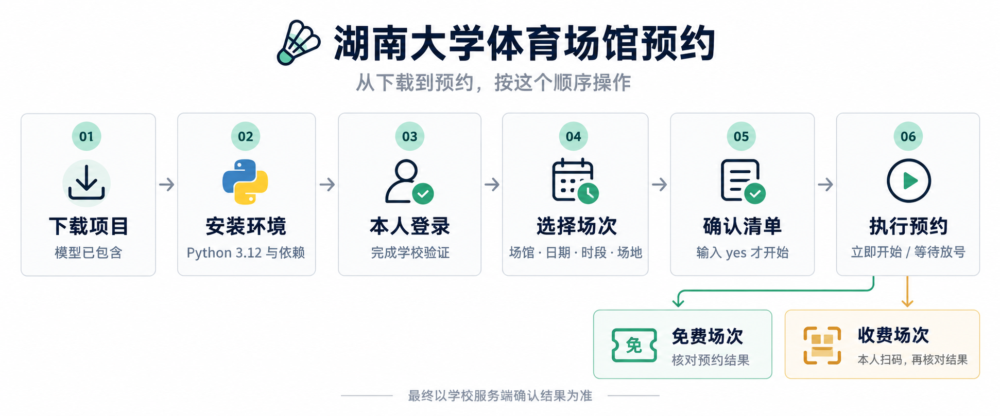

# 湖南大学体育场馆预约助手 🏸

`hnu-sports-booking`：湖南大学（湖大 / HNU）体育场馆预约助手，支持羽毛球预约、健身房预约、乒乓球预约和网球预约。选好日期和时段，确认后开始查询空位，或等到放号时间再执行。收费场次会弹出支付二维码，免费场次直接核对预约结果。

支持的项目从学校预约大厅读取，包括羽毛球、健身房、乒乓球和网球。不同场馆的时间和规则分别处理，不把所有项目都当成一小时的羽毛球场。

**登录验证和扫码付款需要本人完成。这个工具会创建真实预约，请看清最后的确认清单再输入 `yes`。**

## 先看使用顺序

**第一次：下载完整仓库 → 安装 Python 和依赖 → 本人登录 → 打开菜单选场 → 确认预约 → 免费场次确认结果 / 收费场次扫码付款。**



1. **安装只做一次**：在项目文件夹创建 `.venv`，安装 `requirements.txt`。模型已包含在仓库中，不需要另找下载。
2. **首次使用先登录**：运行 `.\.venv\Scripts\python.exe -X utf8 cdp_cookie.py --wait`，在弹出的浏览器中完成验证。
3. **以后直接双击 `一键抢场.bat`**：日期回车选默认，场地回车选不限；时段按编号选择，多段例如 `1,2`。
4. **最后输入 `yes` 才开始预约**：收费场次仍需你扫码。登录过期时重新执行第 2 步。

下面是每一步的具体操作。

## 可以做什么

- 启动后直接选择体育场馆，不需要记场馆 ID。
- 日期支持编号、完整日期和回车默认；今天的场次全部开场后，会隐藏今天。
- 按实际排期选择时段，90 分钟、110 分钟等时段也可以。
- 多段预约要求连续、同一块场地，并遵守场馆单次数量限制；缺一段就继续等待，不自动变成只约一段。
- 场地可以指定，回车默认不限场地。
- 按场馆配置决定是否需要验证码，使用本地模型识别。
- 免费项目不创建支付订单；收费项目核对预约和金额后生成二维码。

已在 **Windows 64 位 + CPython 3.12.14 的全新虚拟环境**中验证依赖安装、模型推理、Tk 窗口和 78 项离线测试。其他系统还没有完整验证；学校登录和账号预约权限仍需使用者自行确认。

## 开始之前

准备好：

1. 能正常登录学校一网通办的账号。
2. 能在浏览器里访问 [一网通办](https://eportal.hnu.edu.cn/v2/site/index) 的网络环境。
3. Python 3.12，以及 Chrome 或 Edge。
4. 完整下载仓库，保留随项目提供的 `models` 文件夹。

不用把学号、密码填进代码。第一次登录时，会打开一个专门的浏览器窗口，由你完成学校要求的验证。

## 1. 下载并安装依赖

把项目下载或克隆到本地，解压后进入包含 `booking_menu.py` 的文件夹。在这个文件夹打开 PowerShell：

```powershell
py -3.12 -m venv .venv
.\.venv\Scripts\python.exe -m pip install --upgrade pip
.\.venv\Scripts\python.exe -m pip install -r requirements.txt
```

如果默认下载源很慢，可以用下面的镜像安装相同依赖。本次干净环境安装验证使用了这个镜像：

```powershell
.\.venv\Scripts\python.exe -m pip install -r requirements.txt -i https://pypi.tuna.tsinghua.edu.cn/simple --no-cache-dir
```

不需要激活虚拟环境，后面的命令直接使用 `.venv` 中的 Python。

如果找不到 `py`，先运行 `python --version`。确认是 Python 3.12 后，把第一条命令换成：

```powershell
python -m venv .venv
```

检查依赖：

```powershell
.\.venv\Scripts\python.exe -c "import numpy, onnxruntime, cv2, PIL, segno, tkinter; from zoneinfo import ZoneInfo; print(ZoneInfo('Asia/Shanghai')); print('依赖检查通过')"
```

`tkinter` 随标准 Windows Python 安装提供，不需要执行 `pip install tkinter`。

## 2. 检查自带模型

模型随仓库一起提供，完整下载项目后不需要再到其他仓库单独下载。项目根目录的 `models` 文件夹应包含：

```text
models/
├── yolo_detect.onnx
├── ppocr.onnx
└── charsets.txt
```

| 本项目需要的文件名 | 上游文件 | 来源 |
| --- | --- | --- |
| `yolo_detect.onnx` | `best_v3.onnx` | [Text_select_captcha / model](https://github.com/MgArcher/Text_select_captcha/tree/master/model) |
| `ppocr.onnx` | `[Dddd]-OCR.onnx` | [AntiCAP / AntiCAP-Models](https://github.com/81NewArk/AntiCAP/tree/main/AntiCAP/AntiCAP-Models) |
| `charsets.txt` | `[Dddd]-CharSets.txt` | 同上 |

三个文件合计约 61 MiB。上表仅用于记录模型来源，正常使用不需要再下载一遍。请保留原文件与字符表的配套关系，不要自行用其他同名模型覆盖。

只预约无需验证码的场馆时，不会加载这两个模型。需要验证码时，文件缺失会在开始预约前报错。

检查模型是否能加载，不登录、不提交预约：

```powershell
.\.venv\Scripts\python.exe -c "from captcha_engine import CaptchaEngine; CaptchaEngine(); print('模型加载通过')"
```

## 3. 登录一次

```powershell
.\.venv\Scripts\python.exe -X utf8 cdp_cookie.py --wait
```

在弹出的浏览器窗口里登录一网通办，完成学校要求的手机验证，然后等终端提示登录成功。

登录状态会保存在项目目录的 `cookie.txt`，以后运行时会检查它是否仍有效。过期后，重新执行这条登录命令即可。

🔐 **`cookie.txt` 相当于登录凭据。不要上传 GitHub、发给别人，或者贴在 Issue 里。**

## 4. 打开预约菜单

双击 **`一键抢场.bat`**，或者运行：

```powershell
.\.venv\Scripts\python.exe -X utf8 booking_menu.py
```

窗口顶部应显示 `HNU Reservation - MENU`，随后出现中文场馆菜单。下面是输入方式示例，具体日期、编号和时段以你的屏幕为准。

### 选择场馆

```text
体育场馆个人预约

选择场馆
  ...
  2. 南校区羽毛球馆
  3. 南校区综合馆（羽毛球）
  ...
```

输入场馆前的编号即可。

这两个南校区羽毛球选项对应不同场地：专用羽毛球馆有 8 块场地，综合馆是在篮球馆内铺设的 6 块羽毛球场地，学校将它们分开预约。

### 选择日期

```text
可选日期（不代表有空位）：
  1. 2026-11-01
  2. 2026-11-02（默认）

直接回车：选择默认日期 2026-11-02
输入示例：1 或 2026-11-01，均选择 2026-11-01
```

- 直接回车：选择标注的默认日期，通常是允许范围内的明天。
- 输入 `1` 或 `2`：选择对应日期。
- 输入 `2026-11-01` 这样的完整日期：也可以。

日期列表按学校规则和当天剩余时段生成，不是固定的两天。**能选这个日期，不代表还有空位**；下一步才会显示时段余量。

### 选择时段

例如羽毛球：

```text
  1. 20:10-21:10  当前可约余量 2
  2. 21:10-22:10  当前可约余量 1

单段示例：输入 1，选择 20:10-21:10
多段示例：输入 1,2，同时预约 20:10-21:10 和 21:10-22:10
```

`1,2` 的意思是**两段都要**。脚本会寻找同一块场地上的完整组合，不会因为只找到一段就先约一小时。

健身房则可能显示：

```text
  1. 16:00-17:50
  2. 18:20-19:50
  3. 20:00-21:30
```

时段直接读取学校排期，不按固定时长拆分。场馆如果只允许单次一段，就只输入一个编号，例如 `3`。时段这一步没有回车默认值，需要明确选择。

满场但未开场的时段也会列出来，可以选择后等待空位；已经开场的时段会过滤掉。

### 选择场地

```text
  0. 不限场地（默认，回车直接选择；多段必须同一块）
  1. 1号场
  2. 2号场
```

回车或输入 `0` 都表示不限场地。输入其他编号，则只预约指定场地。健身房等无需选择子场地的项目，会跳过这一步。

### 选择何时开始

- **立即开始**：确认清单后开始查询，发现符合条件的空位就尝试预约。
- **等待放号**：按该场馆配置的时间等待；时刻已过则立即执行。不会自动改等下一晚。

如果准备等 22:00 放号，可以提前几分钟启动并选好。等待期间保持电脑唤醒、网络连接正常。

最后会展示日期、时段、场地、预计费用和启动方式。看清楚后输入 **`yes`** 才开始；任意步骤输入 **`q`** 退出，最后确认处输入其他内容也会取消。

## 5. 预约之后怎么付款

**免费场次**：核对服务端确认结果，确认生效后直接结束，不创建支付订单。

**收费场次**：核对本次预约和服务端金额，生成二维码并弹窗提醒，由你扫码付款。

点“我已付款，重新检查”只是让脚本再查一次状态，不会把预约直接标记为成功。只有服务端确认生效，程序才显示成功。倒计时如果标注“预计”，就不是学校返回的精确剩余时间。

遇到提交超时、付款结果不明，或提示人工核对时，先到预约大厅查看记录。**不要同时手动下单、反复重启或开多个窗口抢同一场次。**

## 命令行使用

平时使用菜单就够了。直接运行 `auto.py`，包括旧的固定时段命令，默认也会进入菜单。

如果确实需要直接按参数运行，必须显式加 `--non-interactive`。**下面的第一条命令会真实尝试预约，不是演示模式。** 日期请换成目标场馆允许的实际日期。

```powershell
# 真实执行：南校区羽毛球馆，两段连续时段，等到配置时间
.\.venv\Scripts\python.exe -X utf8 auto.py --non-interactive --venue 57 --date YYYY-MM-DD --times "20:10-21:10;21:10-22:10" --at 22:00:00

# 仅做前置检查，不提交预约
.\.venv\Scripts\python.exe -X utf8 auto.py --dry-run
```

| 参数 | 用法 |
| --- | --- |
| `--venue` | 场馆 ID；菜单用户无需手动填写 |
| `--date` | 目标日期，格式为 `YYYY-MM-DD` |
| `--times` | 单段或连续多段的完整时间，多段用分号分隔 |
| `--court` | 指定场地名称，留空不限 |
| `--now` | 立即执行；未指定日期时默认今天 |
| `--at` | 等待本机当天的指定时刻；不自动顺延一晚 |
| `--slots` | 旧的开场小时范围模式，范围内约到一段即停止；不能与 `--times` 同用 |
| `--no-pay` | 只提交预约，不创建支付订单；**仍然会真实预约** |
| `--dry-run` | 只做登录和必要预热检查，不提交预约；仍可能访问学校接口 |

## 开发与测试

```powershell
.\.venv\Scripts\python.exe -X utf8 -m unittest discover -s tests -p "test_*.py" -v
```

离线测试使用合成数据和替代请求，不需要真实 Cookie，也不提交预约。它验证程序分支，不代表每种场馆都做过真实预约测试。

## 项目文件

```text
booking_menu.py       交互菜单与最后确认
booking_catalog.py    场馆、排期和规则读取
auto.py               定时查询、验证码、预约核对、支付衔接
auto_grab.py          HTTP 预约基础接口
shape_adapter.py     预约排期结构适配
captcha_engine.py    本地验证码模型
cdp_cookie.py         人工登录与 Cookie 获取
cookie_refresh.py    登录状态刷新
pure_pay.py           HTTP 支付及订单核对
qr_popup.py           二维码窗口与付款状态检查
tools/                主程序仍需使用的辅助模块
tests/                离线回归测试
models/               随仓库提供的验证码模型与字符表
out/                  运行生成的临时文件，不提交 Git
```

提交 Issue 时，写清楚所用 Python 版本、操作步骤和脱敏后的错误信息即可。不要附上 `cookie.txt`、支付二维码、完整支付链接或原始抓包文件。
